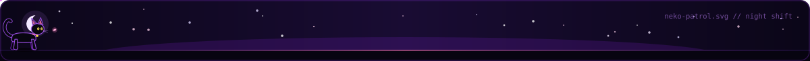

  

  
  
  

  
  
  
  

---

## ✦ Sobre mim

Sou estudante de **Ciência da Computação na UTFPR** (Campo Mourão) e técnico em Análise e Desenvolvimento de Sistemas. Meu foco é **desenvolvimento Backend, bancos de dados relacionais e IA aplicada** — construindo sistemas multi-tenant reais com **segurança e travas determinísticas**.

- **Em produção & incubadora:** criador do [**Vendly**](https://github.com/joaopedrolimadejesus95-beep/vendly), validado em piloto num restaurante real e atualmente em avaliação no **Hotel Tecnológico da UTFPR**.
- **AI Security & Red Team:** criador do [**ATLAS**](https://github.com/joaopedrolimadejesus95-beep/Atlas) e do [**CommitGuard**](https://github.com/joaopedrolimadejesus95-beep/Commit-Guard), unindo AppSec, validação *Ground Truth* no PostgreSQL e CI/CD.
- **Hackathons:** co-criador do [**AgroShield**](https://github.com/heitor1240/AgroShield) no **NASA Space Apps Challenge 2026** (backend, travas da EMBRAPA e gateway SMS 2G offline).
- **Objetivo:** buscando **estágio ou posição júnior em Backend / IA Aplicada** (remoto ou presencial).

 

  

---

## 🛠️ Tech Stack

### Linguagens & Backend

  

`Node.js` · `TypeScript` · `JavaScript` · `Python` · `Java 21` · `Spring Boot` · `Flask` · `REST APIs` · `Socket.io` · `Zod`

### Banco de Dados, Infra & Segurança

  

`PostgreSQL (row lock)` · `SQLite` · `Docker` · `Linux` · `GitHub Actions (CI/CD)` · `AI Red Team (OWASP)` · `MCP` · `AWS`

---

## 📁 Projetos em Destaque

  
  

  
  

  
  

  <strong>Demos ao vivo:</strong>
  <a href="https://joaopedrolimadejesus95-beep.github.io/vendly/">Vendly Site</a> ·
  <a href="https://joaopedrolimadejesus95-beep.github.io/atlas-painel.html">ATLAS Painel</a> ·
  <a href="https://escritorio-de-agentes-ten.vercel.app">AI Office Studio</a> ·
  <a href="https://nectar-notes-flax.vercel.app">NectarNotes</a> ·
  <a href="https://sistema-academico-web.vercel.app">Sistema Acadêmico</a>

  
<strong>📂 Ver outros projetos e destaques técnicos</strong>

   

| Projeto | O que faz | Stack | Link |
|---|---|---|---|
| **NectarNotes** | Plataforma temática de música com autenticação, playlists e pet virtual | `Node.js` · `SQLite` · `JS` | [Código](https://github.com/joaopedrolimadejesus95-beep/Nectar-Notes) · [Demo](https://nectar-notes-flax.vercel.app) |
| **Genius IA** | Chatbot em Flask com Gemini API, detecção de intenção e análise de imagens | `Python` · `Flask` · `Gemini` | [Código](https://github.com/joaopedrolimadejesus95-beep/genius.ia) |
| **ProjetoEnem** | Pipeline em Python que extrai e estrutura questões do ENEM a partir de PDFs oficiais | `Python` · `ETL` · `PDF` | [Código](https://github.com/joaopedrolimadejesus95-beep/ProjetoEnem) |
| **Sistema Acadêmico Web** | Portais de aluno, professor e coordenação portados de Java console para web | `Java` · `JavaScript` | [Código](https://github.com/joaopedrolimadejesus95-beep/Sistema-Academico-WEB) · [Demo](https://sistema-academico-web.vercel.app) |
| **Algoritmos JS** | Cifra de César e lógica com testes unitários no Node Test Runner | `JavaScript` · `Tests` | [Código](https://github.com/joaopedrolimadejesus95-beep/algoritmos-js) · [Demo](https://joaopedrolimadejesus95-beep.github.io/algoritmos-js/) |

---

## 📊 Estatísticas & Streak do GitHub

  
  

  

---

## 🏆 Eventos & Certificações

- **NASA Space Apps Challenge 2026 (*Field Shift*):** Co-criador do **AgroShield** — backend, travas determinísticas da EMBRAPA e gateway SMS 2G offline.
- **Ideathon Sebrae 2025:** Líder de equipe em solução inteligente de reciclagem gamificada.
- **NASA Space Apps Challenge 2024:** Software educacional de prevenção a incêndios e resolução de desafios globais.
- **Certificações recentes:** Anthropic *Claude Academy: Intro to MCP* (nov/2026) · DIO *Bootcamp AWS - Cibersegurança* & *Engenharia de Prompts* (nov/2026) · Google Cloud *Capacita+ Construa com Gemini* (set/2026) · Tera *Digital Product Week* (out/2026).

---

  
🌙 Feito sob a lua de sakura · aberto a novas conexões e oportunidades

  
  
  

